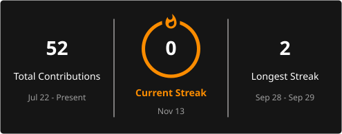

  
  

<h2 align="center">Hey, I'm Heisenberg 👋</h2>

  <b>Vibe Coder • ECE Student • Builder</b>

  I build things, break things, and figure out how they work.

---

### 🧠 About Me

- 🎓 BE / ECE student
- 💻 Interested in web development and embedded systems
- 🔧 Building projects with React, TypeScript, Firebase and ESP32
- 🚀 Learning by actually building things
- 📍 Chennai, India

### 🛠️ Currently Building

- **HabitFlow** — habit tracking and accountability
- **ESP32 projects** — embedded systems and hardware experiments
- **Personal AI / automation projects**

### ⚡ Tech Stack

  

### 📌 Projects

| Project | Description |
|---|---|
| **HabitFlow** | Habit tracking and accountability web app |
| **ESP32 Projects** | Embedded systems and IoT experiments |
| **Jarvis** | Personal AI assistant experiments |
| **WhatsDown** | Independent WhatsApp-inspired messaging project |

---

  <i>Building. Learning. Breaking. Rebuilding.</i>

  

  

&nbsp;&nbsp;

